# Kế hoạch Sản xuất Nội dung: Phương án A (Thế chiến 2 - Mặt trận Tây Âu 1944)
*Theo phong cách The Armchair Historian & Chuẩn Engine 2.5D Multiplane*

---

## 1. Mục tiêu & Định vị kênh

- **Phong cách cốt lõi:** Dựng lại cảnh (Reenactment-first) với hoạt hình cel 2.5D kết hợp sa bàn bản đồ giấy kiểu Armchair Historian; số liệu và mốc thời gian làm chữ phụ đè lên cảnh.
- **Tiêu chuẩn học thuật (`source-policy.md`):** Mọi sự kiện, con số tổn thất, sơ đồ tác chiến đều đối chiếu từ nguồn A/B (sử liệu lưu trữ NARA, sách nghiên cứu của Antony Beevor, Rick Atkinson, Stephen Ambrose, v.v.), không dùng Wikipedia làm nguồn chính.
- **Nguyên tắc sản xuất (`workflow-gates.md`):** Làm pilot 1 cảnh thử nghiệm duyệt style trước khi sản xuất hàng loạt; tận dụng tối đa cơ chế tái sử dụng thư viện asset (Asset Multiplier).

---

## 2. Thư viện Asset cốt lõi Quý 1 (Asset Library Blueprint)

Toàn bộ 12 video của Quý 1 xoay quanh một bộ tài nguyên dùng chung, giúp tiết kiệm tối đa chi phí và công sức vẽ:

```mermaid
graph TD
    subgraph Library["Thư viện Asset Dùng Chung (Content Library)"]
        Char["Nhân vật (Rig 2D)"]
        Veh["Phương tiện & Vũ khí"]
        BG["Cảnh nền 2.5D"]
    end

    Char --> C1["Lính Bộ binh Mỹ (M1 Helmet, M1 Garand, M1941 jacket)"]
    Char --> C2["Lính Nhảy dù Mỹ (101st Airborne, Jump suit M42)"]
    Char --> C3["Lính Wehrmacht Đức (Stahlhelm, Kar98k, Feldgrau)"]
    Char --> C4["Sĩ quan Đức (Peaked cap, MP40)"]

    Veh --> V1["Xuồng đổ bộ Higgins (LCVP)"]
    Veh --> V2["Xe tăng M4 Sherman"]
    Veh --> V3["Xe tăng Panzer IV / Tiger I"]
    Veh --> V4["Pháo phòng thủ Pak 40 & 88mm"]

    BG --> B1["Bờ biển cát + chông sắt Czech hedgehog + hào dốc"]
    BG --> B2["Vùng đồng quê Bocage (hàng rào cây rậm, đường đất trũng)"]
    BG --> B3["Nội thất boongke bê tông & lỗ châu mai hướng biển"]
    BG --> B4["Thị trấn Normandy đổ nát (nhà gạch, gạch vụn)"]

    Library ==> VOD1["Video 1, 4, 6, 7 (Flagship: D-Day & Normandy)"]
    Library ==> VOD2["Video 2, 8, 12 (Evolution: Quân phục)"]
    Library ==> VOD3["Video 3, 9 (Tactical: Boongke & Thiết giáp)"]
    Library ==> VOD4["Video 5, 10, 11 (Standalone & Giao thời)"]
```

---

## 3. Lộ trình 12 Video chi tiết (Roadmap Quý 1)

### Tháng 1: Khởi động Chiến dịch & Đột phá Bờ biển

| Tuần | Tên Video / Tiêu đề YouTube | Định dạng | Hook 30 giây đầu | Asset khai thác | Nguồn căn cứ chính |
| :---: | :--- | :--- | :--- | :--- | :--- |
| **W01** | **D-Day 1944: 24 Giờ Sinh Tử Trên Bãi Biển Omaha** | Flagship (Tập 1) | Cửa xuồng Higgins hạ xuống, khói súng mịt mù, tiếng đạn MG42 xé toạc mặt nước. Lời dẫn: *"Họ được bảo rằng bom đã dọn sạch bờ biển... Họ đã nhầm."* | Xuồng LCVP, lính Mỹ, lính Đức, bờ biển Normandy. | Beevor (2009) *D-Day*; NARA Record Group 407. |
| **W02** | **Sự Tiến Hóa Quân Phục Lục Quân Hoa Kỳ (1917 – 1945)** | Evolution Showcase | 3 nhân vật lính Mỹ đứng cạnh nhau: Doughboy 1917 $\to$ Lính Omaha 1944 $\to$ Lính mùa đông Bastogne 1944. Visual biến đổi trang bị từng lớp. | Rig lính Mỹ qua 3 thời kỳ (Shorts/TikTok cut cực tốt). | Stanton (1991) *U.S. Army Uniforms of WWII*. |
| **W03** | **Bức Tường Đại Tây Dương: Hệ Thống Boongke Đức Vận Hành Ra Sao?** | Tactical Breakdown | Bản đồ mặt cắt 3D một cụm WN (Widerstandsnest) ven biển: hào ngầm kết nối máy phát điện, kho đạn và tháp pháo 88mm. | Boongke bê tông, pháo 88mm, sơ đồ kỹ thuật. | Zaloga (2005) *The Atlantic Wall*. |
| **W04** | **Trận Địa Bocage: Ác Mộng Bụi Rậm Giam Chân Quân Đồng Minh** | Flagship (Tập 2) | Xe tăng Sherman bị lật nghiêng vì vướng rễ cây ngàn năm; hỏa lực Panzerfaust từ góc chết bất ngờ khai hỏa. | M4 Sherman, lính nhảy dù Mỹ, nền cây bụi Bocage. | Doubler (1988) *Busting the Bocage*. |

---

### Tháng 2: Bao vây & Phá vỡ Thế bế tắc

| Tuần | Tên Video / Tiêu đề YouTube | Định dạng | Hook 30 giây đầu | Asset khai thác | Nguồn căn cứ chính |
| :---: | :--- | :--- | :--- | :--- | :--- |
| **W05** | **Đội Quân Ma: Kế Hoạch Đánh Lừa Hitler Bằng Xe Tăng Bơm Hơi** | Standalone Gem | Một người lính một tay nhấc bổng... cả chiếc xe tăng Sherman. Sự thật về đơn vị nghệ sĩ/kỹ sư giải mật của Quân đội Mỹ. | Xe tăng phao, máy phát âm thanh, lính ngụy trang. | Gerard (2002) *The Secret Soldiers*. |
| **W06** | **Túi Falaise: Cuộc Vây Hãm Nghiền Nát Tập Đoàn Quân Số 7 Của Đức** | Flagship (Tập 3) | Con đường rực lửa mang tên "Hành lang Tử thần" tại Chambois: quân Đức tuyệt vọng tháo chạy trước làn pháo kích Đồng minh. | Tàn tích xe cơ giới Đức, lính Wehrmacht kiệt sức. | Blumenson (1961) *Breakout and Pursuit*. |
| **W07** | **[BẢN ĐẶC BIỆT] Toàn Cảnh Chiến Dịch Normandy 1944 (Full Documentary)** | Special Feature | Gộp trọn vẹn Tập 1, 2, 3 thành bộ phim tài liệu dài 45–50 phút. Bổ sung đoạn nối chuyển cảnh và bản đồ tổng thể. | Toàn bộ asset Tháng 1 & 2. | Tổng hợp chuỗi tư liệu chuẩn hóa. |
| **W08** | **Sự Biến Đổi Của Lính Nhảy Dù (1940 – 1945): Từ Fallschirmjäger Đến 101st Airborne** | Evolution Showcase | So sánh trực diện lính dù Đức và lính dù Mỹ: từ kỹ thuật dù treo 1 điểm đến trang bị túi nhảy dù dã chiến. | Rig lính dù Mỹ M42 & lính dù Đức. | Rottman (2006) *US Airborne Units in the ETO*. |

---

### Tháng 3: Cơ giới, Góc khuất & Chuyển giao

| Tuần | Tên Video / Tiêu đề YouTube | Định dạng | Hook 30 giây đầu | Asset khai thác | Nguồn căn cứ chính |
| :---: | :--- | :--- | :--- | :--- | :--- |
| **W09** | **Xe Tăng Sherman vs Tiger: Sự Thật Đằng Sau Huyền Thoại "1 Đổi 5"** | Tactical Breakdown | Sa bàn đạn đạo: góc nghiêng giáp trước xe tăng Sherman, cơ chế vận hành kính ngắm của xạ thủ Tiger I, và vai trò thực tế của không quân chi viện. | M4 Sherman, Tiger I, biểu đồ cơ chế giáp/đạn. | Zaloga (2008) *Armored Thunderbolt*. |
| **W10** | **Trận Đánh Lâu Đài Itter: Ngày Lính Mỹ Và Wehrmacht Sát Cánh Bên Nhau** | Standalone Gem | Một sĩ quan Mỹ và một thiếu tá Wehrmacht cùng ngồi bàn kế hoạch phòng thủ trước đợt tấn công điên cuồng của tàn quân SS. | Lâu đài Áo, lính Mỹ + Wehrmacht chung chiến hào. | Harding (2013) *The Last Battle*. |
| **W11** | **Khúc Dạo Đầu Chiến Tranh Lạnh: Cầu Hàng Không Berlin 1948** | Teaser chuyển giao | Cứ mỗi 30 giây, một vận tải cơ C-47 lại hạ cánh xuống Berlin giữa vòng phong tỏa nghẹt thở của Hồng quân Liên Xô. | Máy bay C-47, gạch vụn Berlin, phi công Mỹ. | Miller (2008) *To Save a City*. |
| **W12** | **Sự Tiến Hóa Quân Phục Hồng Quân Liên Xô (1939 – 1945)** | Evolution Showcase | Mồi asset cho Quý 2 (Mặt trận phía Đông): sự chuyển dịch từ mũ búp sen Budenovka sang mũ sắt Ssh-40 và quân hàm cầu vai 1943. | Rig lính Hồng quân qua 3 mốc (Chuẩn bị cho Quý 2). | Shalito (1997) *Red Army Uniforms*. |

---

## 4. Kế hoạch triển khai Cảnh Pilot (Bước đi đầu tiên)

Theo điều lệ dự án (`workflow-gates.md`), trước khi sản xuất hàng loạt, ta phải hoàn thành **1 Cảnh Pilot duy nhất** để kiểm chứng style cel/multiplane:

- **Đề tài Pilot:** Scene s001 của Video 1 (*D-Day 1944: Bãi biển Omaha*).
- **Quy mô thử nghiệm:**
  - 01 Rig nhân vật: Lính bộ binh Mỹ (M1 Helmet, súng M1 Garand).
  - 01 Asset phương tiện: Xuồng đổ bộ LCVP Higgins (nhìn nghiêng).
  - 01 Cảnh nền 2.5D: Sóng biển dập dềnh + sương mù khói đạn + hàng rào chướng ngại vật xa xa.
- **Tiêu chí nghiệm thu:**
  - Nhân vật có nét mực đen cel-action theo đúng style bible.
  - Chuyển động sóng nước, khói sương và camera đẩy nhẹ mượt mà trên Engine Remotion.
  - Người dùng duyệt still & clip đạt chuẩn trước khi vẽ các asset còn lại.
